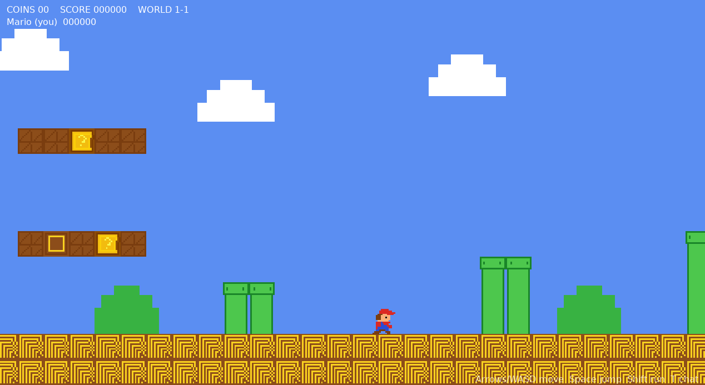

# Love2D Platformer Demo

A small multiplayer classic platformer demo built with
[LÖVE](https://love2d.org/) and the networking library
[Nexilis](nexilis) (via its LuaJIT bindings). One player per client, sharing a
single deterministic "Level 1" that is synchronised over a dedicated server.



## Features

- Classic platformer movement: acceleration, running (hold a run key),
  variable-height jumps, skidding, stomping, brick bumping and power-ups.
- A single hand-built level (Level 1) with pipes, `?` blocks, bricks, coins,
  a flagpole and a castle.
- Deterministic enemies (Blobs / Turtle Troopas), breakable bricks, spawnable
  items (mushroom, fire flower, star), fireballs, coins and score.
- **Multiplayer**: every client drives its own player and sees everyone else.
  Player positions stream over UDP; gameplay events stream over the reliable
  TCP chat channel. No authoritative physics server is required — the shared
  world clock keeps enemy/entity state in lockstep on every client.
- In-game chat (press `T`), six selectable characters and a fire-power palette.

## Layout

| Path | Purpose |
| --- | --- |
| `game/` | The LÖVE game (Lua). `main.lua` is the entry point. |
| `game/net.lua` | Nexilis client wrapper, protocol parser, world-clock sync. |
| `game/world.lua` | Simulation loop, input, camera, HUD, chat, event handling. |
| `game/level.lua` | Level 1 tile map, enemy spawns, tile/decoration drawing. |
| `game/player.lua` | Player physics, remote interpolation, state packing. |
| `game/entities.lua` | Enemies, items, fireballs, block bumps, collisions. |
| `game/sprites.lua` | Procedurally generated pixel-art sprites and palettes. |
| `game/config.lua` | All tunables: physics, tile size, scale, characters, palette. |
| `game/conf.lua` | LÖVE window/config. |
| `game/json.lua` | Tiny JSON decoder for the binding's event payloads. |
| `game/nexilis.lua` | **Generated** copy of the LuaJIT binding, placed by `run.sh`. |
| `server/` | Headless C++ Nexilis server (`main.cc`). |
| `tools/smoke_client.lua` | Minimal standalone binding test. |
| `docs/` | Screenshots used by this README. |
| `build.sh` / `run.sh` | Build the native server/bindings and launch the game. |

## Prerequisites

- LÖVE 11.x (`love` on `PATH`)
- CMake 3.25+, a C++20 compiler, and OpenSSL and Boost development files.
  `build.sh` presets `CI=false`, which prefers your **system** Boost/OpenSSL;
  the Boost vendored in the Nexilis submodule is used as a fallback.
- LuaJIT (for the standalone smoke test)

## Build

```sh
# Native Nexilis bindings + the dedicated server.
./build.sh
```

If the Nexilis submodule is empty, initialise it first:

```sh
git submodule update --init --recursive
```

## Run

Start the server, then launch one or more clients.

```sh
# Terminal 1: the dedicated server (listens on TCP 54200).
./server/build/platformer_server

# Terminal 2..n: one client per player.
./run.sh
```

`run.sh` copies the LuaJIT binding next to the game (LÖVE has its own virtual
file system) and launches `love game`.

### Controls

| Key | Action |
| --- | --- |
| `←` / `→` or `A` / `D` | Move |
| `Shift` | Run |
| `Space` / `X` / `↑` / `W` | Jump |
| `B` / `F` | Throw a fireball (only when you have the fire flower) |
| `1`–`6` | Choose character (title screen) |
| `T` | Chat (then `Enter` to send, `Esc` to cancel) |
| `F11` | Toggle fullscreen |
| `Esc` | Quit |

### Configuration

The client reads a few environment variables:

| Variable | Meaning |
| --- | --- |
| `NX_HOST` | Server address (default `127.0.0.1`). |
| `NX_PASSWORD` | Server password, if the server requires one. |
| `LPD_NAME` | Player name shown to other players. |

## How multiplayer works

Every client broadcasts its `worldTick` (60 ticks/s) about once a second, and
each client merges forward only: it adopts the highest tick it has seen and
never moves backwards. A fresh joiner is therefore pulled forward to the group,
and a client leaving can never drag the clock back. The server is a pure relay
and does not run any game logic.

- **Player positions** are sent about 30 times a second as a small packet: `x`,
  `y` and a packed `z` (character, power state, facing, action, alive, star).
  They travel over UDP, so lost packets only mean a brief interpolation pause.
- **World events** are sent as short text commands over the reliable TCP chat
  channel (each prefixed with `~`). Examples: a block bump, a brick break, a
  coin, an enemy stomp/shell kick, an item spawn, a fireball, a death.
- **Sessions reset cleanly.** Broadcasts are stored by the server and replayed
  to joiners, so a client that finds the room empty starts a new session
  (`~S|<epoch>`) and rebuilds Level 1 from scratch. A joiner replays the
  history in order and ends up exactly where the current session is — no stale
  kills or broken bricks from a previous game.
- **Enemies and items are deterministic.** A Blob is a pure function of the
  `worldTick` and the level geometry, so no per-enemy traffic is needed; only
  *state changes* (e.g. "Blob #3 was stomped") are broadcast, tagged with the
  tick they happened on. Items are simulated forward from their `spawnTick`.
  Fireballs are only *authoritative* for the client that fired them (everyone
  else applies the resulting `~E` hit), which keeps kills identical everywhere.
- Chat and system notices reuse the same channel; system lines (starting with
  `>`) and protocol lines (starting with `~`) are filtered out of the chat.

## Development notes

`./build.sh` builds the Nexilis native libraries and the server. The game code
is plain Lua and needs no build step; `./run.sh` picks up changes immediately.

For headless integration testing (used during development) the client honours
extra variables: `LPD_AUTOSTART`, `LPD_TEST_SECONDS`, `LPD_SCRIPT=walk`,
`LPD_CHAR`, `LPD_POWER`, `LPD_DEBUG` and `LPD_SCREENSHOT`. With these
you can run a scripted player under `xvfb-run` and capture a screenshot without
a display.

```sh
LIBGL_ALWAYS_SOFTWARE=1 SDL_AUDIODRIVER=dummy \
  LPD_AUTOSTART=1 LPD_SCRIPT=walk LPD_TEST_SECONDS=15 \
  xvfb-run -a ./run.sh
```

## License

The game code in this repository is released under the **MIT License** — see
[`LICENSE`](LICENSE). Copyright (c) 2026 Valtteri Viirret.

The project depends on [Nexilis](nexilis), which is licensed under the
**GNU LGPL-3.0-or-later** and is vendored as a git submodule. Note that
`game/nexilis.lua` is a generated copy of Nexilis's LuaJIT binding (placed by
`run.sh`) and therefore carries the same LGPL license; do not edit it by hand.

All art in this project is original procedural pixel art.
